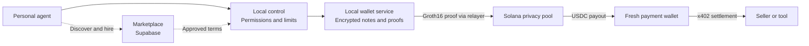

# Veilo

A personal agent workspace with private on-chain payments and an agent marketplace, built on Solana devnet.

Create agents, connect tools, set permissions and hire specialists. Local control and wallet services authorize spending; a Groth16 privacy pool funds fresh payment wallets for x402 merchant settlement.

## Product

- **Personal agents:** configurable instructions, jobs, read-only browsing and approved MCP connectors.
- **On-chain wallet:** deposits, encrypted notes, proof-authorized payouts, owner withdrawals and an approved USDC-to-SOL swap path.
- **Marketplace:** specialist listings, workflows, local hiring approvals, direct seller payments and private deliverables.
- **Owner control:** per-purchase, task, agent and workspace limits; pause/revoke; durable payment reconciliation.

## Architecture



The local wallet service holds note secrets; the fresh wallet is a per-purchase payment address. Groth16 authorizes the pool withdrawal; x402 settles the merchant payment. [Technical details](docs/guide/architecture.md).

## Status and evidence

Veilo is a development prototype. Use devnet test funds only; it is not audited or ready for production funds. Amounts, payment addresses, merchants and timing remain public. Spending caps are enforced by local services, not the ZK circuit.

- [Current product status](https://seann004.github.io/Veilo-agent-wallet/guide/status.html)
- [Execution evidence and submission files](https://seann004.github.io/Veilo-agent-wallet/evidence.html)
- [Security assessment](https://seann004.github.io/Veilo-agent-wallet/security/assessment.html)

Recorded devnet transactions demonstrate pool withdrawals, x402 payments and owner exits. They retain their original execution dates and do not establish every current workflow's end-to-end acceptance. The current marketplace fee is zero; paid subscriptions are not implemented.

## Run locally

Requires Node.js 22.14–24, pnpm 10.34.6 and the setup prerequisites in the [running guide](docs/guide/running.md).

```sh
pnpm install --frozen-lockfile
pnpm setup:local
pnpm dev
```

Setup creates `.env` only if missing. Before starting, configure your own wallet, deployment and provider accounts using the [running guide](docs/guide/running.md). A clone contains no operator API keys, wallet keys or funded accounts. Devnet tokens do not pay model/provider bills; those use your own credits. Keep secrets local and never reuse another operator's credentials.

The dashboard runs at `http://localhost:3000`. Marketplace services start when their configuration is present. Supabase stores marketplace identity and product data; the local wallet keeps note secrets and signing authority.

## Verification

```sh
pnpm check
pnpm test
```

For circuit/program and full integration checks, follow the [verification guide](docs/security/evidence.md). Recorded results and remaining checks are in [current status](docs/guide/status.md). Tests, deployment scripts and public evidence are under `tests/`, `scripts/` and `artifacts/`.

## Documentation

[Architecture](docs/guide/architecture.md) · [Protocol](docs/protocol.md) · [Deployment](docs/deployment.md) · [Configuration](docs/configuration.md) · [Privacy](docs/guide/privacy.md)

```sh
cd docs
npm ci
npm run dev
npm run build
```

The documentation build regenerates the AI-context files. Required third-party license notices remain in `NOTICE`.
