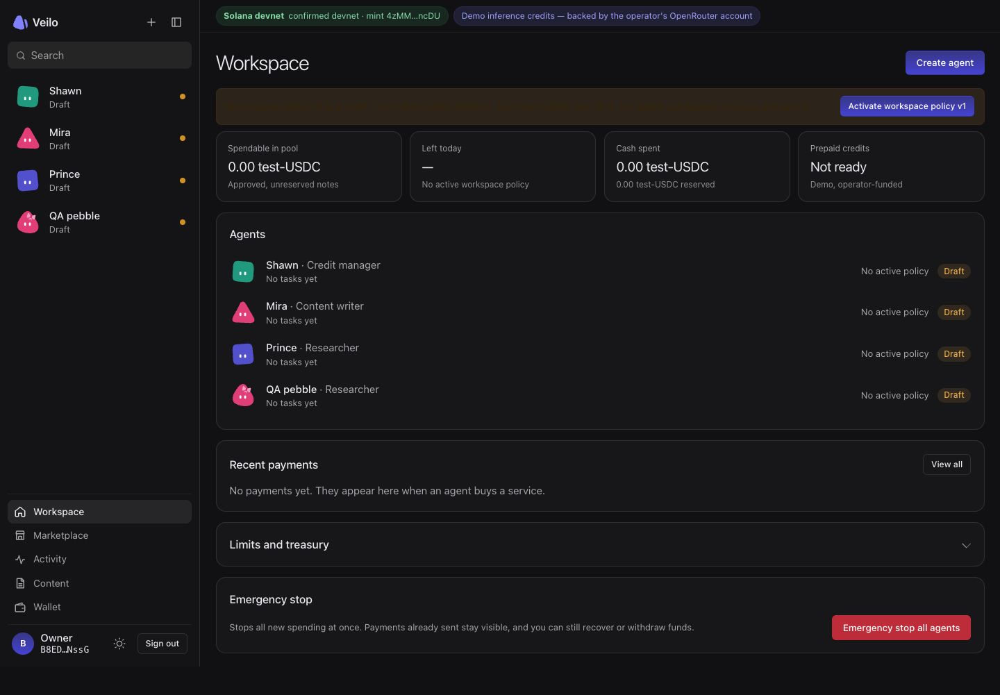

# Dashboard PR review

Reviewed on 17 October 2026 for PR #2 (`feat/dashboard-redesign` into `main`).

## Adversarial review

Astra at low reasoning effort reviewed the branch against `main`, then reviewed the fixes. The final follow-up found no further actionable regressions. This was a source review; the browser and build checks below were performed separately.

| Finding | Resolution |
| --- | --- |
| P1: Back from create-agent review remounted the original limits, which could disagree with the policy being submitted. | Seed the returning form from the reviewed policy. Verify edited limits, approval requirements and payment paths survive Back and later edits. |
| P2: repeated Enter presses could submit multiple tasks while the first request was pending. | A synchronous in-flight guard in `useAction` rejects concurrent calls. Research and campaign composers also guard submission and disable the prompt while busy. |
| P2: “24 hour cap of 1 USDC” used 24 as the allowance. | Exclude the supported 24-hour period from amount parsing; reject ambiguous multiple amounts, negative amounts, unsupported periods and numeric comma separators. Leading decimals are normalized without rounding. |
| P2: closed mobile navigation retained invisible keyboard targets. | Make it inert and hidden; focus the close button on opening, wrap Tab within the drawer, make background content inert, and restore menu-button focus when closing. Desktop navigation remains available. |
| P2: custom selects put the active-descendant attribute on an unfocused listbox. | Focus the listbox, update its active option, support Home/End, scroll the option into view, and restore trigger focus after picking or Escape. Avoid focus scrolling and stationary-pointer hover changing keyboard selection. |

The real-backend UI pass also found an empty researcher/content role configuration displaying “checks every undefined s.” Policy summaries now render top-up rules only when all displayed credit-manager fields are valid. The new social card also uses the configured dashboard origin for its absolute metadata URL.

The existing PR documentation failure was reproduced from its CI log: the asset brief linked outside VitePress's published documentation root. That link now targets the permanent GitHub source revision; strict dead-link checking remains enabled. The brief also points readers to the delivered assets rather than calling all of them placeholders.

## Verification

- `pnpm check`: passed, using Node 22 and pnpm 10.34.6.
- `pnpm test`: **302 passed, 8 skipped**; 45 test files passed and 1 skipped. The eight existing conditional skips depend on circuit/prover build artifacts; this dashboard review did not build those prerequisites.
- `pnpm --filter @veilo/dashboard build`: passed. The reviewed production build used `VEILO_DASHBOARD_ORIGIN=http://localhost:43100` and `DASHBOARD_PORT=43100`.
- `npm --prefix docs run build`: passed with strict dead-link checking. The existing bundle-size advisory remains non-fatal.
- Browser: **96 page/navigation combinations** across 1440×960 and 375×960, light/dark, desktop expanded/collapsed navigation, and mobile closed/open drawers. No horizontal overflow or broken images was found.
- Routes: `/`, `/marketplace`, `/workspace`, `/agents/new`, all three actual default-agent detail URLs, `/market`, `/activity`, `/content`, `/wallet`, `/recovery`, `/privacy`.
- Keyboard: the drawer traps Tab in both directions, Escape closes it and returns focus; closed navigation is inert. The listbox receives focus and announces its active option through `aria-activedescendant`.
- Actual create-agent flow: edit limits and approval tier, Review, Back, confirm preservation, create a draft, open its real detail URL, and confirm the persisted policy. No policy was activated.
- Actual avatar flow: select colour and shape independently; Woman adds the ribbon, Man and Non-binary do not; save and reload the draft-agent page. Saved appearance persisted with no mobile overflow.
- Final targeted checks after the policy-summary fix covered all three roles at both widths and themes. Only the credit manager displays a top-up rule; no `undefined` text remains. No browser console errors were captured on the final workspace view.
- The rendered social image URL resolves to the explicitly configured review origin. Production builds should set `VEILO_DASHBOARD_ORIGIN` to their intended dashboard origin, as also required by owner-session/proxy configuration.

## Coverage boundaries

The UI ran against a disposable local control ledger with a generated test owner and the backend's real default draft-agent records. Its chain guard confirmed the actual devnet genesis and test mint. This setup had no funding, provider credentials or spending scheduler. A draft named “QA pebble” was created through the actual backend for the save/reload check; its policy stayed inactive. Displayed zero balances and empty lists came from that ledger, not mocked browser responses.

The wallet and relayer were not started in this isolated setup, so their unavailable/error states were reviewed. This pass does not claim a new paid-work, recovery or withdrawal run, or screen-reader hardware testing. Those backend outcomes were not fabricated. The original landing screenshot remains deferred: it needs an appropriate real devnet run and must not use the local QA screenshot below as marketing evidence. Optional role art and empty-state illustrations remain outside this delivery.

The earlier asset-only pass's unauthenticated-owner limitation is superseded by this authenticated draft-workspace review, subject to these service boundaries. Raw route and screenshot evidence from this session is retained locally in `/private/tmp/veilo-final-ui-review/`.

