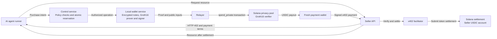
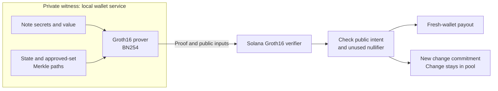
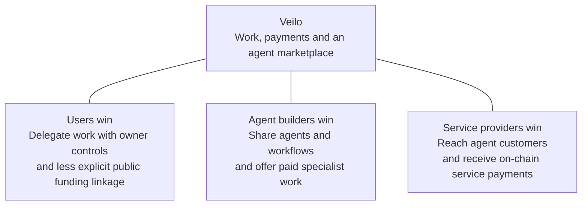

# Veilo: presentation content and speaker notes for owner review

The previous content was reviewed with GPT-6 Astra at low reasoning effort against the exact Topic F statement supplied by the owner on 19 October 2026. This revision incorporates the owner's subsequent slide-by-slide edits and has not had a new Astra review. This replaces the earlier budget-first proposal. This is the canonical presentation-content proposal, pending owner approval. The PowerPoint and native Keynote versions include the revised visual design and a spoken script on each slide. Presenter notes contain only the spoken script; references and review context remain in this source document. There is no demo slide or embedded demo segment.

## Exact organizer statement

> Autonomous On-chain Wallet: The track’s signature topic — build an AI wallet agent that autonomously executes on-chain operations (asset management, transaction execution, risk control). Ambitious ideas are encouraged, with a 0–5 point challenge bonus.

This is the supplied statement, not an independently verified competition page. It does not establish devnet eligibility or reuse acceptance. Bonus points are discretionary and no score is predicted.

## Narrative and timing

Veilo is a personal agent workspace, private on-chain funding wallet and marketplace. Audience: individuals, builders and business owners. Wallet execution is the core Topic F connection. Spending controls support the product rather than define it.

12 slides, target speaking time **about 7–8 minutes**, depending on pace. Architecture and proof mechanics receive more time in this revision. A website demonstration is separate. Rehearse the complete session below the organizer's ten-minute presentation maximum if showing the website during the presentation slot.

## 1. Veilo (0:15)

**On slide**

Small topic label: **Autonomous on-chain wallet**

**Veilo**

**Your personal agent workspace, private on-chain payments and agent marketplace**

Create agents. Pay for their work. Hire specialists and run workflows.

**Speaker notes**

Hi, this is Veilo. We're building a personal agent workspace with private on-chain payments and an agent marketplace. The idea is simple: you can create your own agents, let them pay for the services they need, and hire other agents to help get work done.

## 2. Who it is for (0:25)

**On slide**

- Individuals who want personal agents to get work done.
- Builders connecting agents to tools and on-chain payments.
- Business owners delegating work and hiring specialists.

Shared need: useful automation, payment privacy and owner control.

**Speaker notes**

Veilo is for anyone who wants their own agent workspace. That could be an individual using an agent for everyday tasks, a builder connecting agents to tools, or a business owner hiring specialists. The shared need is getting useful work done, with payment privacy and control over what the agent can do.

## 3. Our solution (0:30)

**On slide: one Veilo container with three columns**

| Personal agent workspace | Private on-chain payments | Agent marketplace |
|---|---|---|
| Create agents and coordinate their work. | Pay approved services using ZK pool withdrawals. | Hire specialists and run reusable workflows. |
| Review results and activity in one place. | Keep spending within owner permissions. | Automate hiring within explicit owner grants. |

**Speaker notes**

Our solution has three parts in one workspace. First, you create and manage your personal agents. Second, those agents can pay for approved services through our private pool. Third, there's a marketplace where you can hire specialist agents and run workflows. So the agent has somewhere to work, a way to pay, and access to help when it needs it.

## 4. Features (0:30)

**On slide**

- Personal agents with configurable instructions and tools.
- **ZK-proof-based private pool payments.**
- Agent marketplace specialists and multi-step workflows.
- Automated hiring within explicit owner grants.
- Third-party MCP connectors, browsing, spending controls and recovery.

Small evidence qualification: Components implemented; end-to-end verification varies.

**Speaker notes**

Here are the main features. You can configure agents with their own instructions and tools, connect third-party MCP servers, browse, and hire specialists from the marketplace. For payments, we use zero-knowledge proofs. Automated hiring stays within permissions you explicitly grant. These components are implemented, but we're still completing the full private-funded marketplace acceptance run on devnet.

## 5. Autonomous on-chain operations (0:30)

**On slide**

- **Asset management:** shared funding, agent allowances and tracked exposure.
- **Transaction execution:** proof-authorized withdrawals and x402 settlement.
- **Risk control:** caps, approved recipients, expiry, revoke and replay protection.

Designed for autonomous execution within owner-defined permissions.

**Speaker notes**

This is how Veilo connects to the autonomous on-chain wallet topic. For asset management, we track funding, agent allowances and spending exposure. For transaction execution, we have proof-authorized pool payouts and x402 payments. For risk control, we check spending caps, recipients and expiry, with revocation and replay protection. The agent can act within the permissions you set; it can't give itself more authority.

## 6. Technical architecture (0:50)

**On slide: editable technical diagram**

**Diagram callout:** Groth16 authorizes the pool withdrawal. x402 handles the merchant-payment leg.

**Speaker notes**

Here's the payment flow. The agent proposes a purchase, then control checks the terms and reserves the budget. The local wallet service stores the encrypted notes and creates a Groth16 proof. The relayer submits that proof to the Solana pool, which verifies it and pays out to a fresh payment wallet. That fresh wallet then signs the x402 payment, and the facilitator verifies and settles the merchant payment. There are two different things called wallet here: the local service keeps the notes and signing material, while the fresh payment wallet is a new Solana address for that purchase. Groth16 handles the pool withdrawal; x402 handles paying the seller.

Sources: docs/guide/architecture.md; docs/protocol.md; docs/guide/payments.md. Budget enforcement is off chain, on the trusted owner-controlled host.

## 7. How private payments work (0:50)

**On slide: proof boundary diagram**

**The proof establishes**

- Knowledge of the note secrets and membership in the state tree and approved set.
- Value conservation: note value equals withdrawal plus change.
- A nullifier tied to the spent note and a new change commitment.

**Public:** roots, nullifier, withdrawal value, intent context and change commitment. Merchant payments and timing also remain public.

**Speaker notes**

A note is basically a private record of your claim to funds in the pool. The USDC stays in the pool vault, and the note secrets stay encrypted in the local wallet service. Say you have a 10 USDC note and want to pay 3, ignoring separate fees. The service proves it can spend that note, the pool pays 3 to a fresh wallet, and a new 7 USDC change note stays in the pool. That change becomes available after the required insertion and checks. Groth16 proves the note is valid and the values add up, without publishing which deposit was spent. A nullifier prevents spending the same note twice. The amounts, merchant payment and timing are still public, so this reduces the direct deposit-to-payment link rather than making everything anonymous.

Sources: circuits/src/spend.circom; docs/protocol.md sections 7 and 9; docs/guide/privacy.md. Do not say the ZK circuit enforces per-agent budgets.

## 8. Technology stack (0:20)

**On slide**

| Layer | Technology |
|---|---|
| Frontend | Next.js |
| Blockchain | Built on Solana |
| Privacy | Groth16 zero-knowledge proofs |
| Marketplace database and identity | Supabase |
| Third-party integrations | x402 payments and MCP connectors |

**Speaker notes / Q&A**

The frontend is Next.js, and the payment layer is built on Solana. Groth16 provides the privacy proofs. Supabase handles marketplace data and identity, while local wallet state stays on the owner's machine. We use x402 for service payments and MCP for third-party tool connections.

Sources: circuits/src/spend.circom; circuits/scripts/build.ts; docs/protocol.md; https://github.com/iden3/snarkjs .

## 9. Execution evidence (0:35)

**On slide: three receipt panels**

1. **Private pool withdrawal** — Groth16 proof verified; 0.01 devnet USDC paid to a fresh wallet.
2. **x402 merchant payment** — same fresh wallet paid 0.01 devnet USDC to PayAI Echo. Echo is a smoke merchant and refunds payments.
3. **Owner withdrawal** — 0.20 devnet USDC returned from a separate eligible pool note to its owner through a public on-chain transaction.

Use the captured real Explorer screenshots, shortened clickable hashes, slots and finalized status. Keep full transaction hashes in the notes and an evidence table.

**Visible label:** Recorded 17 October 2026, Solana devnet. Rechecked 19 October: all three finalized, no on-chain error. Public exit is separate from the paid-purchase path.

- **Private pool withdrawal**, slot `512001315`: [2fbWQ6ws2y2sHFUgBeELnKVsdVKZwpBnx6ma9kkwhkHtdw9ki2fBq14UN3nqdFMBcGsLQKUVK36aE1w7DBcPJLE3](https://explorer.solana.com/tx/2fbWQ6ws2y2sHFUgBeELnKVsdVKZwpBnx6ma9kkwhkHtdw9ki2fBq14UN3nqdFMBcGsLQKUVK36aE1w7DBcPJLE3?cluster=devnet)
- **x402 merchant payment**, slot `512001369`: [3mChKemwTiirm9TvVpFMzbKiMQAkDB8SMX74nWgkmjhzijY2TRszZQpkET6PU6EQD5p6oEQt7jds2JmwSWLJWReA](https://explorer.solana.com/tx/3mChKemwTiirm9TvVpFMzbKiMQAkDB8SMX74nWgkmjhzijY2TRszZQpkET6PU6EQD5p6oEQt7jds2JmwSWLJWReA?cluster=devnet)
- **Owner withdrawal**, slot `512001396`: [52EVL9oes4qKYArNqEFySbC7g5pNwEVxAo9bMZ7JXNNRqoVC6yeeBoPGarvequ2sDT78Xb2YRarN5t8XLmT8BEZu](https://explorer.solana.com/tx/52EVL9oes4qKYArNqEFySbC7g5pNwEVxAo9bMZ7JXNNRqoVC6yeeBoPGarvequ2sDT78Xb2YRarN5t8XLmT8BEZu?cluster=devnet)

**Speaker notes**

These are real devnet transaction receipts. The first shows a 0.01 USDC pool payout to a fresh wallet. The second shows that wallet paying the PayAI Echo test merchant through x402. Echo refunds its test payments. The third is a separate 0.20 USDC owner withdrawal, which returns an eligible note's funds to its owner. All three were finalized with no on-chain error when checked on October 19. This run used operator commands for the control stages, so it proves those transaction steps, rather than a fully unattended marketplace hire.

Evidence sources: artifacts/evidence/m2-spend.json, m2-merchant.json, m2-exits.json. Recheck: public Solana devnet RPC getSignatureStatuses, searchTransactionHistory=true, 19 October 2026. Existing screenshot assets: outputs/veilo-presentation/.build/assets/receipt-0.png through receipt-2.png (local build assets).

## 10. Impact: win, win, win (0:25)

**On slide: three beneficiaries around Veilo**

**Speaker notes**

The impact we're aiming for is a win for all three sides. Users can delegate useful work and keep control of spending. Builders can share agents and workflows and earn from specialist work. Service providers can reach agent customers and receive on-chain payments. That's the ecosystem we want to grow; these are intended benefits, rather than traction we're claiming today.

## 11. Business model (0:30)

**On slide: proposed pricing**

**One subscription: $9 per month**

Use the personal agent workspace and publish/share agents or workflows.

**Marketplace commission: 3%**

Deducted from seller revenue on completed marketplace sales. No Veilo percentage fee on payments outside the marketplace.

**Speaker notes**

For the business model, we're proposing one workspace subscription at 9 dollars a month, plus a 3 percent commission on completed marketplace sales. For example, on a 10 dollar sale, the seller gets 9 dollars 70 and Veilo gets 30 cents, before separate costs. We wouldn't take a percentage from other payments. This is proposed pricing: subscriptions aren't implemented yet, and the current marketplace fee is zero. Model and external service costs would be separate.

## 12. Five-year direction (0:40)

**On slide: five-year timeline**

- **Year 1:** independent smart-contract and circuit audits, close known gaps and onboard early users to devnet pilots.
- **Year 2:** controlled mainnet pilots after audit fixes and a suitable trusted setup; validate the single subscription and marketplace commission.
- **Year 3:** grow the agent marketplace, seller ecosystem and developer SDK.
- **Year 4:** expand business workspaces, collaboration and operational controls.
- **Year 5:** broaden payment integrations and strengthen privacy as usage grows.

**Speaker notes**

For the five-year direction, year one is about auditing the contracts and circuits, fixing gaps, and onboarding early users on devnet. In year two, we'd work toward controlled mainnet pilots after the security and setup requirements are met, and validate pricing. Year three is about growing the marketplace and developer SDK. Year four expands business workspaces and collaboration. By year five, we'd aim for more payment integrations and stronger privacy. That's the direction, with production use depending on the security work being completed first.

## Content-review status

This revision follows the owner's slide-by-slide feedback. Topic F remains explicit on slides 1 and 5, with asset management, transaction execution and risk control. Real receipts anchor slide 9. Pricing is proposed, current fees remain zero, and operational evidence limits stay visible in notes and evidence captions. The PowerPoint and Keynote versions have been rebuilt with the revised diagrams and spoken presenter notes. No demo slide is included.

## Visual revision

Inter body text paired with Space Grotesk headings. No page/slide counts. Use the flat original Veilo mark and wordmark rather than mascot imagery as the logo. Add structured content containers, especially for audience, features and Topic F capabilities. Keep actual technology logos distinct from generic proof notation. The five-year roadmap uses a winding road with five stops inspired by the supplied reference. Rename the public-exit receipt to Owner withdrawal and explain that its transaction is public.
